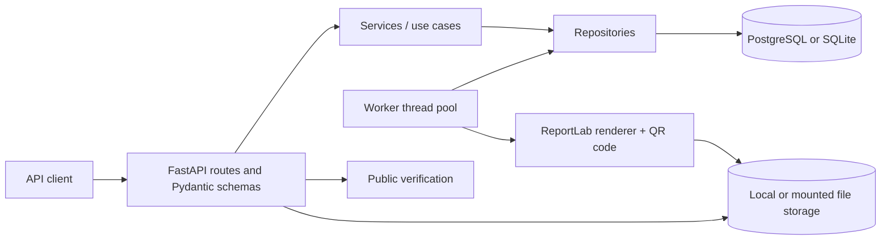

# Bulk Certificate Generator

A production-minded REST API for accepting one bulk certificate request, validating each recipient independently, generating PDF certificates in a database-backed worker, and downloading individual PDFs or a streamed ZIP.

## Features

- **Bulk submission:** one `POST /api/batches` request can contain up to 5,000 recipients by default.
- **Partial validation:** malformed recipients are rejected with their input index; valid rows continue.
- **Idempotency:** an optional `Idempotency-Key` prevents duplicate batch creation, including when concurrent requests race.
- **Durable background work:** jobs and recipient statuses live in SQLAlchemy-managed tables; startup recovery returns interrupted work to the queue.
- **PDF certificates:** ReportLab output includes a QR code and a cryptographically random certificate number. Latin text stays searchable; Devanagari text is shaped with HarfBuzz and drawn as vector outlines using the bundled Noto Sans font.
- **Safe downloads:** individual PDFs and ZIP archives stream from disk. The ZIP writer uses a bounded queue and the database cursor fetches records incrementally.
- **Public verification:** certificate lookup reveals certificate/event details, never the recipient's email address.
- **Operational basics:** Alembic migrations, request IDs, structured JSON logs, request-body limit, Docker Compose, CI, and tests.

## Architecture

```text
Client -> FastAPI routes/schemas -> Services -> Repositories -> PostgreSQL/SQLite
                                      |              ^
                                      v              |
                               Renderer/storage   Worker pool
                                      |
                                      v
                                  PDF files
```



The HTTP layer maps request schemas into service commands. Services own validation and workflow rules; repositories contain SQLAlchemy queries; infrastructure adapters handle rendering, storage, numbering, and time. The worker claims rows transactionally (with `SKIP LOCKED` on PostgreSQL), generates a certificate, persists each result, and allows up to two retries (three total attempts).

## Design decisions and trade-offs

- **Database-backed queue:** it keeps job state durable and avoids adding Redis/Celery to a small service; PostgreSQL row locking coordinates multiple workers. A dedicated queue becomes useful when job volume, scheduling, or retry policies outgrow this simple polling model.
- **Synchronous SQLAlchemy:** endpoints are ordinary `def` handlers, so FastAPI runs blocking database and file work in its thread pool instead of blocking the async event loop. The same persistence code works with SQLite locally and PostgreSQL in deployment.
- **ReportLab:** it creates PDFs directly in Python without a browser runtime or external rendering service. The single template is drawn in code so layout remains inspectable; more complex branding may justify a template engine later.
- **Local file storage:** it keeps development and single-container deployments self-contained. Multi-instance deployments need a shared `StorageBackend` adapter (for example, S3-compatible object storage) and shared database.

## Run locally

Requires Python 3.11+.

```bash
cd bulk-certificate-generator
python -m venv .venv
source .venv/bin/activate        # Windows: .venv\Scripts\activate
python -m pip install -r requirements.txt
cp .env.example .env
make run
```

The app defaults to SQLite at `./data/app.db`, writes PDFs to `./data/certificates`, applies Alembic migrations at startup, and listens on port `5000`. OpenAPI docs are at `http://localhost:5000/docs`.

If you prefer explicit commands:

```bash
uvicorn app.main:app --host 0.0.0.0 --port 5000 --reload
alembic upgrade head                  # optional; app startup also migrates
```

For Replit, install from `requirements.txt` and use this run command:

```bash
uvicorn app.main:app --host 0.0.0.0 --port ${PORT:-5000}
```

The repository includes `.replit.template`; rename it to `.replit` at the repository root if you want Replit to use this command automatically.

When deploying on Replit, set the PostgreSQL connection URL as `DATABASE_URL` using the Secrets/environment-variable interface; do not commit it in `.env`.

## Docker Compose

Docker Compose starts the API and PostgreSQL, stores database and certificate files in named volumes, and waits for the database health check:

```bash
docker compose up --build
```

The compose file has a local-only default database password to make first boot simple. Set `POSTGRES_PASSWORD` before using this outside a local development machine. If a password contains URL-reserved characters, URL-encode it in the `DATABASE_URL` value.

## Configuration

Copy `.env.example` to `.env` for local use. Settings are also read from environment variables.

| Variable | Default | Purpose |
|---|---|---|
| `DATABASE_URL` | `sqlite:///./data/app.db` | SQLite or PostgreSQL URL. PostgreSQL URLs are normalized to psycopg 3. |
| `STORAGE_DIR` | `./data/certificates` | Local PDF storage directory. |
| `MAX_RECIPIENTS` | `5000` | Maximum number of raw recipients accepted per batch. |
| `WORKER_THREADS` | `4` | Concurrent certificate-generation workers per app process. |
| `WORKER_ENABLED` | `true` | Start the background worker pool with the application lifespan. |
| `PUBLIC_BASE_URL` | `http://localhost:5000` | Public origin embedded into QR verification URLs. |
| `API_KEY` | unset | Optional shared key required on batch and certificate management endpoints. |
| `LOG_LEVEL` | `INFO` | Standard Python logging level. |
| `REQUEST_BODY_LIMIT_BYTES` | `2000000` | Maximum accepted HTTP request-body size. |

For PostgreSQL, either `postgresql://...` or `postgresql+psycopg://...` is accepted. The app uses the `psycopg` v3 driver. SQLite is useful for a single process or local development; use PostgreSQL for multiple app instances.

## API

### Create a batch

```bash
curl -i http://localhost:5000/api/batches \
  -H 'Content-Type: application/json' \
  -H 'Idempotency-Key: workshop-2026-09-30' \
  -d '{
    "event_title": "Python Fundamentals",
    "issuer_name": "Northstar Academy",
    "issue_date": "2026-09-30",
    "description": "Successful completion of the course.",
    "recipients": [
      {"name": "José Müller", "email": "jose@example.org"},
      {"name": "प्रिया शर्मा", "email": "priya@example.org"},
      {"name": "", "email": "bad@example.org"}
    ]
  }'
```

Returns `202 Accepted` for a new job, with `batch_id`, counts, rejected recipient indexes/reasons, and status/download URLs. Replaying the same idempotency key with the same canonical JSON body returns the original response with `200 OK`. Reusing that key with a different body returns `409 Conflict` and error code `idempotency_key_reused`. Valid recipients continue even if other items are invalid; a request with no valid recipients returns `422`.

When `API_KEY` is set, send it as `X-API-Key` on batch and certificate management requests. If unset, these endpoints remain open for local demos. `/health`, `/docs`, `/openapi.json`, and `/api/verify/{certificate_number}` remain public. Use Replit Secrets or another secret manager for a real key; do not commit it.

### Check batch progress

```bash
curl http://localhost:5000/api/batches/<batch_id>
```

The response includes `pending`, `succeeded`, `failed`, `rejected_count`, and completion percentage. `pending` includes both queued and currently processing certificates.

### List certificates in a batch

```bash
curl 'http://localhost:5000/api/batches/<batch_id>/certificates?limit=100&offset=0'
curl 'http://localhost:5000/api/batches/<batch_id>/certificates?status=done'
```

This management endpoint includes recipient email addresses. If `API_KEY` is configured, provide the `X-API-Key` header. The API key is a single shared secret, not per-user authorization.

### Download one PDF

```bash
curl -OJ http://localhost:5000/api/certificates/<certificate_id>/download
```

Returns `409 Conflict` while the certificate is still pending or processing, `404 Not Found` for an unknown ID or missing file, and `200 OK` with a PDF when ready.

### Download the batch ZIP

```bash
curl -OJ http://localhost:5000/api/batches/<batch_id>/download
```

The archive contains the successfully generated PDFs. A batch with no generated files returns `409 Conflict`. The ZIP is assembled incrementally with bounded buffering rather than building the whole archive in memory.

### Public verification

```bash
curl http://localhost:5000/api/verify/<certificate_number>
```

Returns validity, certificate number, recipient name, event, issuer, and issue date. It never returns the recipient email.

### Health

```bash
curl http://localhost:5000/health
```

The readiness check runs a minimal query against the configured database.

## Verifying on PostgreSQL

The default concurrency test runs four live workers against a temporary SQLite database. To run the same 200-recipient, four-worker scenario against the PostgreSQL service in Docker Compose:

```bash
docker compose up -d db && \
docker compose run --build --rm --no-deps \
  -e WORKER_THREADS=4 -e WORKER_ENABLED=false \
  app python scripts/verify_postgres_concurrency.py
```

The script checks that all 200 certificates complete exactly once, then removes its test batch and generated files. Use the included local-only Compose database or another disposable PostgreSQL database; it runs the latest Alembic migrations. Stop the database afterwards with `docker compose down`.

## Demo data

With the API running, submit one 50-recipient sample batch:

```bash
python scripts/seed_demo.py
# Optional: API_BASE_URL=http://localhost:5000 python scripts/seed_demo.py
```

## Database and migrations

- The app applies checked-in Alembic migrations before it starts accepting requests.
- Run migrations manually with `alembic upgrade head` after installing requirements.
- The migrations create `batches` and `certificates`, their status fields, the idempotency constraint and request hash, certificate-number uniqueness, and indexes used by workers and list endpoints.
- To create a new migration after changing the models: `alembic revision --autogenerate -m "describe change"`, then review the generated file before applying it.

## Tests and quality checks

```bash
python -m pytest
ruff check .
ruff format --check .
mypy --strict app/
# or run the same checks via:
make ci
```

The test suite covers health, partial recipient validation, duplicate recipients, idempotency replay/conflicts, optional API-key access, maximum batch size, worker success and retry, startup recovery, Devanagari shaping, downloads/ZIP integrity, safe filenames, public verification privacy, and four-worker processing of 200 certificates on SQLite.

## Changelog / fixes

- Added HarfBuzz shaping and vector outlines for Devanagari, plus visual/layout tests for pre-base vowel marks and conjuncts. Latin-only text continues through ReportLab’s regular searchable text path.
- Limited recipient names to two measured lines at 14 points or larger; long unbroken tokens wrap only at shaped cluster boundaries, and the name block now grows down from a fixed anchor.
- Set the generation limit to three total attempts: one initial attempt and up to two retries.
- Bound each idempotency key to a SHA-256 hash of canonical JSON; mismatched bodies now receive `409 idempotency_key_reused`. Existing rows gain the nullable column through migration `0002_request_hash`.
- Added optional `API_KEY` protection for management routes, using constant-time comparison; health, documentation, OpenAPI, and public verification remain open.
- Added the four-worker SQLite concurrency test and a one-command PostgreSQL verification script.

## Rendering limitations

The renderer shapes Devanagari and Devanagari Extended characters with the bundled font. Other complex scripts—including Arabic, Tamil, and Thai—are not shaped; they need suitable font files and script-specific shaping support. Devanagari is drawn as vector paths, so that text is not selectable or searchable in the PDF.

## Deploying beyond local development

- Configure `API_KEY` or add a full authentication/authorization layer, rate limiting, and retention controls before exposing batch-management endpoints to the internet. This starter has no user/account model; `API_KEY` is one shared secret.
- Local disk storage is suitable for one container or a shared mounted volume. For horizontally scaled deployments, implement `StorageBackend` with shared object storage and configure a shared PostgreSQL database.
- Run the API behind TLS and a reverse proxy; set `PUBLIC_BASE_URL` to the externally reachable HTTPS origin so QR codes resolve correctly.
- The worker pool runs in each app process. Database row locking prevents duplicate work, but tune `WORKER_THREADS` for CPU and database capacity.
- For larger workloads, move job delivery to a dedicated queue such as Celery/Redis and consider webhooks for completion notifications.
- The bundled font is covered by the SIL Open Font License; see `OFL-NotoSansDevanagari.txt`.

## Repository layout

```text
app/
  api/                 Routes, dependencies, and request/response schemas
  core/                Settings, logging, and application errors
  db/                  SQLAlchemy session and database setup
  infrastructure/      Clock, numbering, ReportLab renderer, local storage
  models/               Batch and certificate ORM entities
  repositories/         All application SQL queries
  services/             Validation and business use cases
  worker/               Durable queue polling and crash recovery
alembic/                Versioned database migrations
tests/                  Unit and integration tests
scripts/seed_demo.py    Demo batch submission
```
